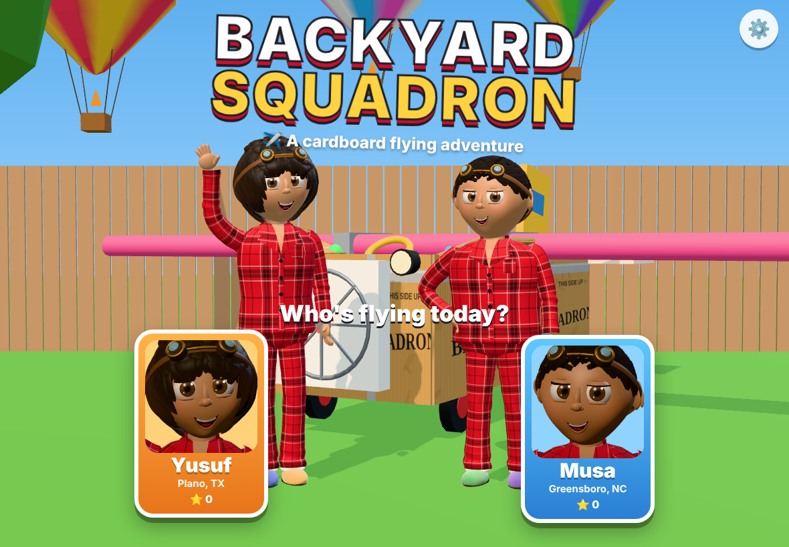
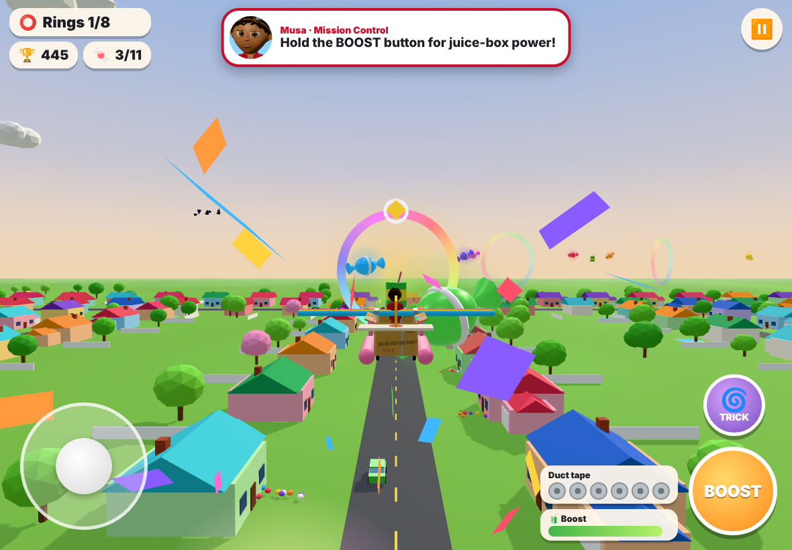
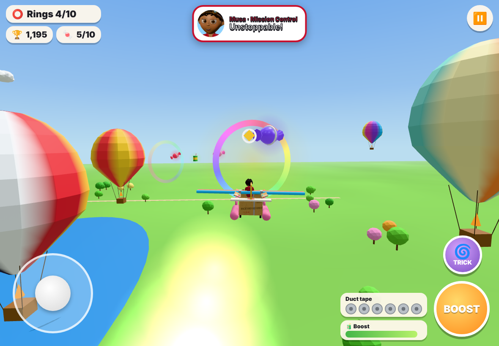
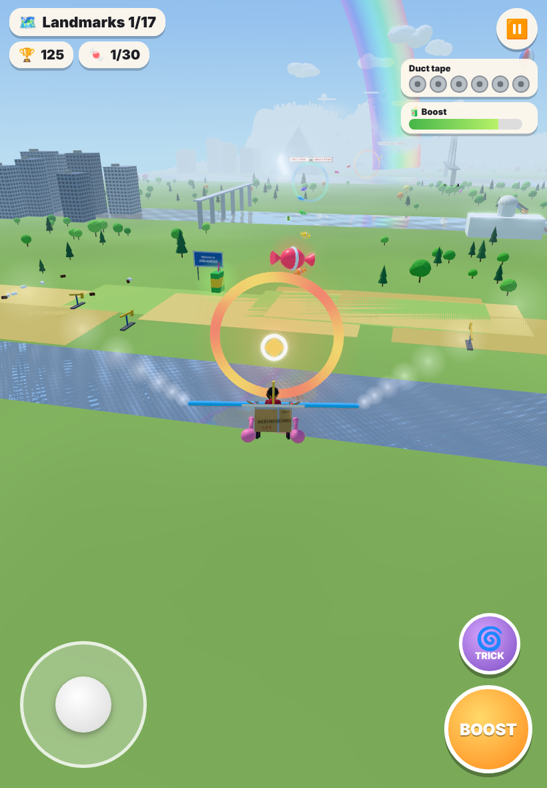
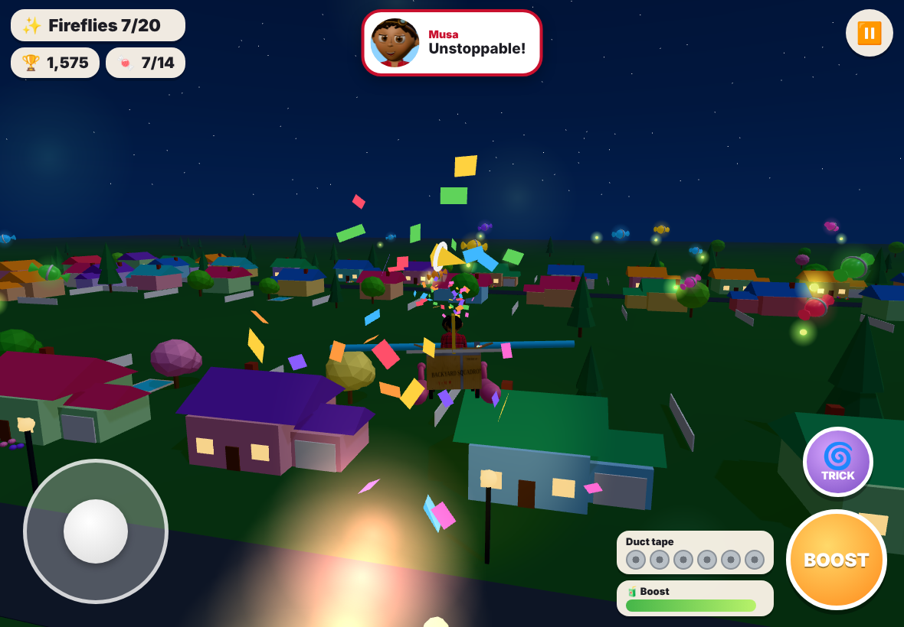
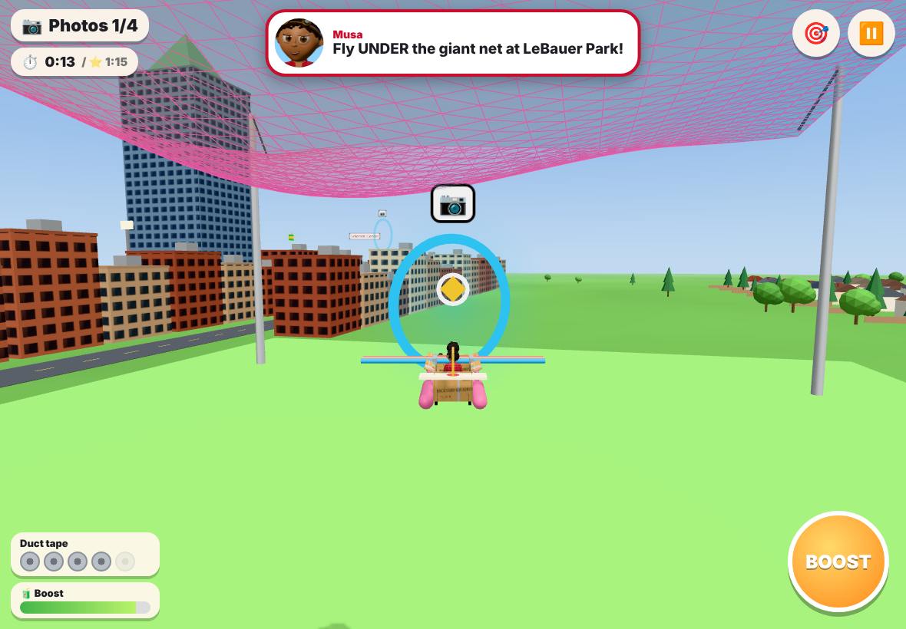
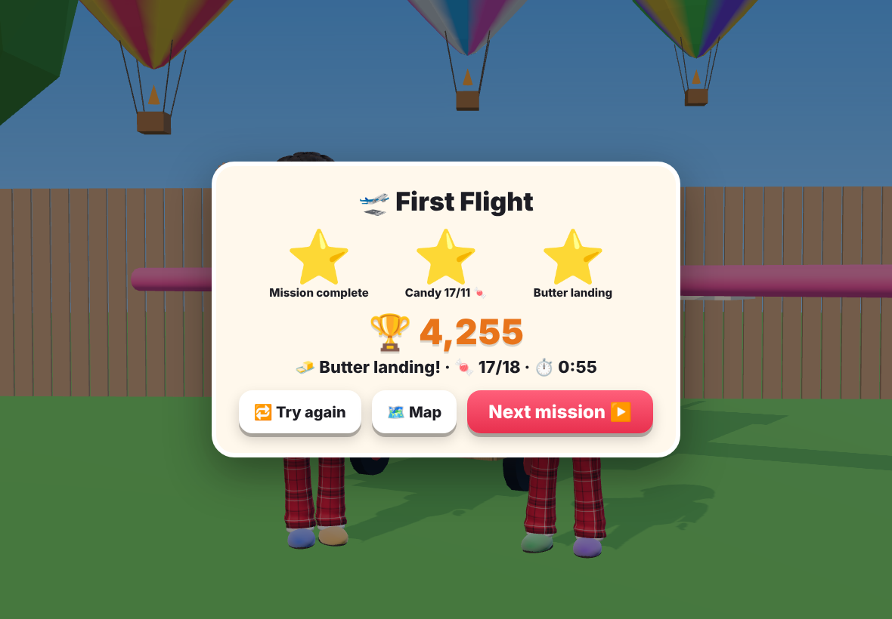

# ✈️ Backyard Squadron

A short 3D flying game for iPad starring **Yusuf** (Plano, TX) and **Musa** (Greensboro, NC), two best friends in matching red plaid pajamas who fly a cardboard-box plane. It runs in the browser, in landscape, and is built with [Three.js](https://threejs.org) and [Vite](https://vitejs.dev).



**Play time:** about 45–60 minutes for 8 missions plus the long flight between states. Every mission has 3 stars to earn and a hidden lost sock 🧦.

## How to play

1. Open the game on the iPad and turn it **sideways**. It only plays in landscape.
2. Tap **Share → Add to Home Screen**. It then opens full-screen like a real app.
3. Pick who's flying today: **Yusuf** or **Musa**. Each boy has his own save, stars and plane.
4. Tap **Start Engines!** Drag the stick on the left to steer and hold **BOOST** on the right.
5. Want to steer by tilting? Go to ⚙️ Settings → **Tilt (gyro)**. First lock the screen rotation (hold the iPad sideways, swipe down from the top-right corner, tap 🔒), or the screen will flip when you tilt.

No sound? Turn the volume up. The game unlocks sound on the first tap and also plays when an iPhone's silent switch is on (iOS 17+).

| Control | Touch stick (default) | Tilt (optional) | Keyboard / game controller |
|---|---|---|---|
| Turn | Left stick | Tilt like a steering wheel | ← → / A D / left stick |
| Climb / dive | Stick up / down | Tip the iPad toward / away from you | ↑ ↓ / W S |
| Boost | **BOOST** button | **BOOST** button | Space / A button |
| Barrel roll | **🌀 TRICK** button | **🌀 TRICK** button | E / B button |
| Recenter tilt | | 🎯 button | |

Every mission has 3 stars: **finish it**, **collect enough candy 🍬**, and make a **Butter landing 🧈** in the green strip. Grab things quickly for **combos 🔥** and tap **🌀 TRICK** (E key / B button) for barrel rolls and bonus points.

The game helps kids out: big rainbow rings, gentle aim-assist toward the next target, a candy magnet, a ground cushion, 6 rolls of duct tape, and a **Landing helper** that's on by default.

 Stars buy plane upgrades in the **Garage**: umbrella wings for tighter turns, a leaf-blower engine for a bigger boost tank, and flamingo floats for landing on water. The **Landing helper** setting makes landings easier.

### Missions
| # | Mission | Place |
|---|---|---|
| 1 | First Flight | Yusuf's cul-de-sac, Plano |
| 2 | Downtown Dash | Historic Downtown Plano |
| 3 | Balloon Festival | Oak Point Park, Plano |
| 4 | Big City: Dallas | Reunion Tower and the Trinity River |
| – | The Long Flight | Texas → Arkansas → Tennessee → North Carolina |
| 5 | Firefly Night | Musa's neighborhood, Greensboro |
| 6 | Lake Brandt Splashdown | Lake Brandt (needs Flamingo Floats) |
| 7 | Gate City Tour | Downtown Greensboro: depot, LeBauer Park, ballpark, Science Center |
| 8 | Big City: Raleigh | The giant acorn chase and the Dix Park sunflowers |

| | |
|---|---|
|  |  |
|  |  |
|  |  |

## Run it locally

```bash
npm install
npm run dev        # http://localhost:5173 (on your Wi-Fi too, for testing on the iPad)
npm run build      # production build in dist/
```

## Put it on Vercel

1. Push this repository to GitHub (already done).
2. At [vercel.com](https://vercel.com) choose **Add New → Project**, import this repository, and pick the branch to deploy.
3. Vercel detects **Vite** automatically: build command `npm run build`, output folder `dist`. Click **Deploy**.
4. Open the URL on the iPads and **Add to Home Screen**.

Tilt steering needs HTTPS, which Vercel provides automatically.

**Privacy:** the game is meant to be shared only by link. It tells search engines not to index it (`robots.txt`, `noindex`, and an `X-Robots-Tag` header in `vercel.json`). Homes and streets in the game are made up. Progress is saved only on each iPad, with no accounts and no data collection.

## Project layout

```
src/
  main.js         app, title screen, game loop
  characters.js   Yusuf & Musa 3D models (procedural)
  plane.js        the cardboard plane + upgrades
  flight.js       flight model + tilt / touch / keyboard input
  mission.js      objectives, collisions, landings, scoring, autopilot
  levels.js       all missions, landmarks and dialogue
  world/kit.js    scenery kit (houses, buildings, trees, sky, lighting)
  world/props.js  balloons, trains, acorn, fireflies, net sculpture, pickups
  hud.js, ui.js   in-flight HUD and menus
docs/GAME_DESIGN.md   the design doc
tests/                headless checks (Playwright)
```

## Tests

The tests use Playwright with Chromium: the autopilot flies every mission to check it can be completed.

```bash
npm run build && npm run preview &
node tests/smoke.mjs http://localhost:4173     # flies all 9 missions on autopilot
node tests/flow.mjs  http://localhost:4173     # menus → mission → results → next mission
node tests/screens.mjs http://localhost:4173   # screenshots into tests/out/
```
